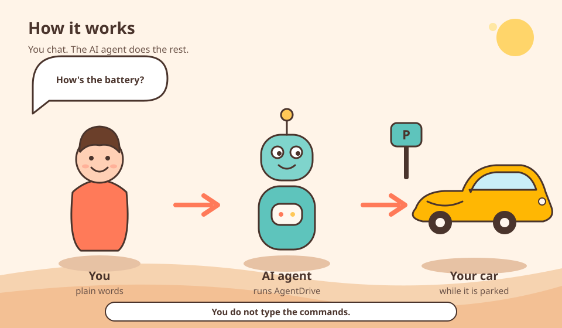
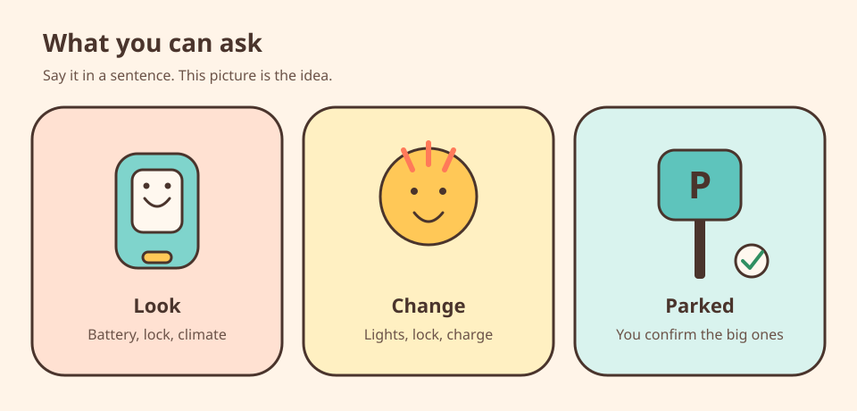
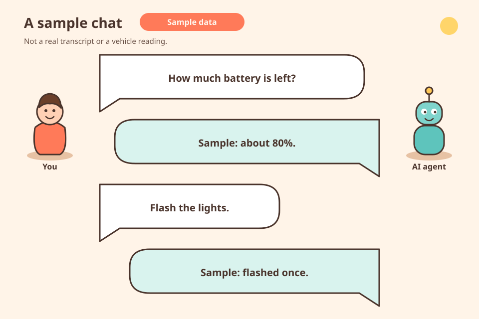

# AgentDrive

Turn your AI agent into your car concierge.

[](LICENSE)
[](#supported-agents)

AgentDrive is unofficial. It is not affiliated with, endorsed by, or supported by Tesla.

You chat in plain words with an AI agent. That AI agent translates the chat into AgentDrive commands. You do not learn or type those commands. Grok Bot, Muse, or any shell-capable AI agent uses this same path. You register your own developer application, publish your own public key, and keep every secret on your own machine. The public key is hosted on GitHub Pages (`<username>.github.io`). You do not buy a domain. Docs are published at <https://agentdrive-dev.github.io/agentdrive>.

## How to start

**You just chat in plain words. The AI agent translates that into AgentDrive commands. You do not need to learn, memorize, or type the CLI commands.**

You already have an AI agent that can run shell commands on a computer. Grok Bot brings its own computer. Muse or any other shell-capable AI agent uses this same path.

Copy this prompt and paste it to your AI agent. Then do only the approvals it asks for.

```text
Install AgentDrive from https://github.com/agentdrive-dev/agentdrive.
Clone it to ~/agentdrive and read README.md, DISCLAIMER.md, and SECURITY.md.
Show me the disclaimer and the security reminder in full, then stop and wait.
Do not install anything until I reply in a later message with this sentence:
I have read, understood, and accept the AgentDrive disclaimer and security reminder
After that, follow "What the AI agent runs" in the README one step at a time,
tell me whenever a step needs me (GitHub login, the Tesla developer app and billing, browser Tesla sign-in, the virtual key in the Tesla phone app),
and keep every secret in ~/.config/agentdrive (or $AGENTDRIVE_HOME), never in chat or in the repo.
The same install is used for every shell-capable AI agent. Do not invent a second installer.
After install, run agentdrive report-schedule. The default is 07:30 local time and enabled.
Create a daily job at that time that runs agentdrive report and send me the result every day,
including the skip line when the car is asleep. If I later ask for a different time or to turn
the report off, update the stored schedule and update that job. AgentDrive does not run it itself.
```

After you paste it, the AI agent shows [DISCLAIMER.md](DISCLAIMER.md) and [SECURITY.md](SECURITY.md) in full, then stops. You reply in a later message with the acceptance sentence below. Same-turn acceptance is rejected. The installer checks the stamp and will not create it. The AI agent then installs one step at a time and interrupts only for the approvals in [What you will do](#what-you-will-do).

### What you need

- A [Tesla account that owns the car](docs/prerequisites/vehicle-account.md).
- A [Tesla that supports virtual keys](docs/prerequisites/vehicle-compatibility.md) (most cars from 2021 on do).
- An [AI agent](docs/prerequisites/assistant.md) that can run shell commands on a [computer](docs/prerequisites/computer.md), for example Grok Bot (brings its own computer), Muse, or any shell-capable AI agent.
- A [Tesla developer account](docs/prerequisites/developer-app.md) with a [payment method and a billing limit above 0](docs/prerequisites/billing.md). It uses the same Tesla login, not a new account. Tesla bills API use. A $10 monthly credit is published for individual developers.
- A [GitHub account](docs/prerequisites/public-key-host.md), used to host the public key on GitHub Pages. You do not buy a domain.

### What you will do

[About an hour, mostly approvals.](docs/prerequisites/time.md)

1. Paste the prompt above to your AI agent.
2. Read the [disclaimer](DISCLAIMER.md) and the [security reminder](SECURITY.md), then reply in a separate message with: `I have read, understood, and accept the AgentDrive disclaimer and security reminder`
3. Approve GitHub login once when asked.
4. Create the Tesla developer app and add billing when asked. The AI agent tells you what to fill in. Put the secret in a file, never in chat.
5. Sign in to Tesla in your browser when the AI agent gives you a link.
6. Approve the key in the Tesla app on your phone. See [Virtual key](docs/prerequisites/virtual-key.md).

Everything else (installing, publishing the key, registering, tokens, doctor, the daily report, test command) your AI agent does and reports back.

[Full step-by-step guide](docs/00-before-you-start.md#full-step-by-step-guide)

## How it works



The AI agent runs AgentDrive on your computer after you chat. Reads use the Tesla Fleet API. Parked commands are signed with your key. Those commands act while the vehicle is parked. AgentDrive does not drive the vehicle.

## What this version does



**This table is a reference, not homework. You chat in plain words. The AI agent runs these commands for you. You do not need to learn, memorize, or type them.**

These are the commands the AI agent can run in `agentdrive` today. Grok Bot and Muse have been used for basic real-car commands. That trial does not cover every command in this repository.

`agentdrive status` may wake a sleeping car. `agentdrive check`, `agentdrive report`, `agentdrive where`, and `agentdrive charge-schedule show` never wake. `agentdrive wake` is a separate command. A parked command is sent only in Park at speed 0, then the car is read once. `wake` does not use that park check. The VIN in a status reading is masked. Status, check, and the daily report do not request location. `where` requests location only when the car is already online, and it prints a coarse area rather than coordinates.

`agentdrive doctor` checks the local setup. `agentdrive refresh` refreshes the access token. A later command refreshes on its own when fewer than 30 minutes remain.

| Command | Confirmation |
| --- | --- |
| `where` | no, and it does not wake the car |
| `wake` | no, and it does not use the park check |
| `flash`, `honk`, `lock` | no |
| `climate-on`, `climate-off` | no |
| `set-temp <C>` | no, and only 15 to 28 C |
| `unlock` | yes, one time |
| `charge-start`, `charge-stop` | yes, one time |
| `charge-limit <percent>` | yes, one time, and only 50 to 100 |
| `charge-schedule show` | no. It does not wake a sleeping car |
| `charge-schedule set <days> <time> <latitude> <longitude>` | yes, one time |
| `charge-schedule remove <id>` | yes, one time |

Unlock and charging changes are immediate commands. A scheduled job cannot run them or confirm them.

### In-car charging timetable

```bash
agentdrive charge-schedule show
agentdrive charge-schedule show --json
agentdrive charge-schedule set weekdays 22:00-06:00 1 2 --confirm "I confirm charging schedule set"
agentdrive charge-schedule set all 23:30- --once --confirm "I confirm charging schedule set"
agentdrive charge-schedule set Mon,Wed -06:00 1 2 --enabled false --confirm "I confirm charging schedule set"
agentdrive charge-schedule remove 1700000000 --confirm "I confirm charging schedule remove"
```

`charge-schedule show` reads the in-car timetable (`charge_schedule_data`) and leaves a sleeping or offline car asleep. `set` adds one schedule. `remove` deletes one id. `set` and `remove` are charging changes: they wake a sleeping car, then require Park, speed 0, and a fresh confirmation. A scheduled job cannot confirm them. The coordinates `1` and `2`, and the id `1700000000`, are placeholders.

`days` is `all`, `weekdays`, or a comma-separated list of `Sun`, `Mon`, `Tues`, `Wed`, `Thurs`, `Fri`, `Sat` (full names are accepted). `time` is a 24-hour window in the vehicle's local time: `22:00-06:00`, a start only (`22:00-`), or an end only (`-06:00`). The end may fall on the next day. Latitude and longitude are the charging-site coordinates in decimal degrees, from -180 to 180. `--once` runs the schedule one time; omit it to repeat every week. `--enabled false` adds the schedule turned off. The default is on.

`show` prints the id, whether the row is enabled, the days, the start and end, weekly or once, the charging-site coordinates, and a name when the car sends one. The field list and the firmware note are in [Queries and commands](docs/06-queries-and-commands.md#in-car-charging-timetable).

### Check, daily report, and update

```bash
agentdrive check
agentdrive report
agentdrive report-schedule
agentdrive report-schedule set 07:30
agentdrive report-schedule disable
agentdrive report-schedule enable
agentdrive where
agentdrive update
```

`agentdrive check` prints that it skipped, and exits 0, when the car is not online. When the car is online it exits 1 for a TPMS warning, a tyre below the threshold, a low battery that is not charging, the car unlocked or open while parked, or a charge error. `agentdrive check --json` prints a short object. On install, the AI agent is asked to run that check every few hours and to notify only when the exit code is 1.

`agentdrive report` prints a short briefing the AI agent should send to you: battery, charge connection, lock, gear, doors, windows, trunk, sentry, climate, tyres, and TPMS. It reads the same parked snapshot as `check` and does not request location. If the vehicle list says the car is asleep, offline, or otherwise not online, it prints the same skip line as `check` and exits 0. A timeout or HTTP 408 is the same skip. It never wakes the car. `--json` prints that briefing as an object. This is a report to send every time, including the skip line. It is not an alerts-only health check.

The default schedule is 07:30 in your local timezone, and it is enabled. `agentdrive report-schedule` shows that time. The setting is stored in the private config home (`$AGENTDRIVE_HOME/runtime.yaml`, or `~/.config/agentdrive` when the variable is unset) only after you change it. After install, the AI agent creates a daily job at the configured time, runs `agentdrive report`, and sends you the result. Say when you want a different time, or when you want the report off. The AI agent then runs `report-schedule set HH:MM`, `disable`, or `enable`, and updates its own job. AgentDrive does not run in the background, and it does not rewrite that job, a crontab, or a systemd timer. The schedule command prints a crontab example for a host that prefers cron. The recommended setup is this 07:30 local daily report. It still needs the AI agent, or a cron line you add yourself, to start it.

`agentdrive where` prints a suburb or locality, a state or region, and a country. It skips, and does not wake the car, when the car is asleep or offline. A rounded point (two decimal places, about 1 km) is sent to OpenStreetMap Nominatim so the place name can be resolved. The precise point is not sent. Coordinates are not printed. If the token lacks the `vehicle_location` scope, the command says to re-authorize with that scope.

`agentdrive update` updates this checkout from the latest `main` and leaves private config in `~/.config/agentdrive` (or `$AGENTDRIVE_HOME`).

## Next

Work we intend to add:

- Trunk, frunk, and remote start on the command line. The signed-command path, the park check, and the one-time confirmation already cover those actions.
- Onboarding, trip advisor, charging tips, and news watch. Onboarding walks registration after the disclaimer gate. Trip advisor compares a planned drive with current range from a saved suburb, and keeps live coordinates out of the AI agent's memory. Charging tips turns charging history and nearby stall counts into a short suggestion. News watch speaks only when a public recall or safety notice needs the owner to act.
- An investigation of charging history, and later of Fleet Telemetry for historical queries. History field names in the client are still unconfirmed against a live response. How telemetry readings would be received and stored still needs a revised design.

## Illustrative example



The figures are sample data, not a vehicle reading or a transcript.

## Disclaimer

Experimental and testing purposes only. AgentDrive is unofficial and is not a Tesla product. Use it only on a vehicle you own, or a vehicle you are explicitly allowed to control. To the maximum extent permitted by law the software is provided as is, and the author's liability is excluded. Nothing here excludes a right under the Australian Consumer Law that cannot be excluded. The full text is in [DISCLAIMER.md](DISCLAIMER.md). Read [SECURITY.md](SECURITY.md) before you install.

## What the AI agent runs

Your AI agent runs this install after you paste the prompt in [How to start](#how-to-start) and send the acceptance sentence in a later message. Grok Bot, Muse, and any other AI agent that can run shell commands use this same install.

1. Get the code.

```bash
git clone https://github.com/agentdrive-dev/agentdrive.git ~/agentdrive
cd ~/agentdrive
```

2. Read [DISCLAIMER.md](DISCLAIMER.md) and [SECURITY.md](SECURITY.md) in full. The AI agent must show both documents and then stop. In a later message, reply with this sentence:

`I have read, understood, and accept the AgentDrive disclaimer and security reminder`

3. From the repository root, after that separate acceptance, record it and install. Use a different `--turn-id` for each chat message. Same-turn acceptance is rejected. The installer checks the stamp and will not create it.

```bash
PYTHONPATH=. python3 -m core gate-present --turn-id 1
PYTHONPATH=. python3 -m core gate-accept --turn-id 2 --statement "I have read, understood, and accept the AgentDrive disclaimer and security reminder"
bash setup/install.sh
```

`gate-present` prints the disclaimer and the security file in full.

After install, the AI agent reads `agentdrive report-schedule`. The default is 07:30 local time and enabled. It creates a daily job at that time that runs `agentdrive report` and sends the result every day, including the skip line when the car is asleep. A later change of time, or turning the report off, is `agentdrive report-schedule set HH:MM`, `disable`, or `enable`. The AI agent then updates its own job. AgentDrive does not install that job.

## Supported agents

| Agent | Status | Notes |
| --- | --- | --- |
| [Grok Bot](https://grokbot.ai) | Supported — basic real-car commands tried on a vehicle | Adapter `grokbot`. |
| Any agent that can run shell commands | Supported through the template | Adapter `template`. Works with AI agents such as coding agents or self-hosted bots that can run `python3` and `bash` on your computer. |
| Muse | Supported — basic real-car commands tried on a vehicle | Adapter `muse`. |

Basic real-car commands were tried with Grok Bot and with Muse. That trial does not cover every command in this repository.

Host detection, including the environment variables the installer reads, is documented in [AI agents](docs/07-assistants.md#host-environment-variables).

Want another agent? Copy `adapters/template.py`, then open an issue or a pull request.

## Layout

`config/` holds hosts, scopes, and generic vehicle capabilities. `core/fleet` talks to the API. `core/safety` enforces park, confirmation, and the install gate. `core/profile` stores suburb-level habits. `adapters/` connects the AI agent. `setup/` installs, publishes the public key, and runs doctor.

## Contact

agentdrivedev@gmail.com

## Reporting

Ordinary problems go to [GitHub Issues](https://github.com/agentdrive-dev/agentdrive/issues). Vulnerabilities go through [private vulnerability reporting](https://github.com/agentdrive-dev/agentdrive/security/advisories/new). Reports are reviewed and fixed promptly. Do not include secrets, a VIN, or a live location.

## Acknowledgements

Thanks to [MuseDrive](https://github.com/ukhhh/musedrive) for the original idea and working approach that inspired AgentDrive. MuseDrive is MIT-licensed; its notice is preserved in [NOTICE](NOTICE).

## License

MIT License, Copyright (c) 2026 AgentDrive contributors. See [LICENSE](LICENSE). The MuseDrive MIT notice is kept, unchanged, in [NOTICE](NOTICE). MuseDrive is at <https://github.com/ukhhh/musedrive>.
