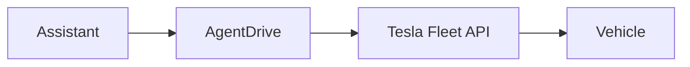

# AgentDrive

[](LICENSE)
[](#supported-agents)

Turn your AI assistant into your car concierge.

AgentDrive connects a car you own to an assistant you already use. You register your own developer application, publish your own public key, and keep every secret on your machine. The assistant can then report status and send a parked command when you ask.

AgentDrive is unofficial. It is not affiliated with, endorsed by, or supported by Tesla.

Docs are published at <https://agentdrive-dev.github.io/agentdrive>.

## What you can ask

These are the commands this version actually runs:

- Battery, lock, climate, and tyre status. `agentdrive status` may wake a sleeping car.
- A read-only check that does not wake a sleeping car.
- Flash the lights, honk, lock, or unlock.
- Climate on or off, and a set temperature from 15 to 28 C.
- Charge start, charge stop, or a charge limit. Each one is a single command, not a charging schedule.

A command that changes the car is sent only in Park at speed 0. Unlock and any charging change need a fresh confirmation. This version has no trunk, frunk, or remote-start command.



## Example chat

Example only. This is not a transcript, and the numbers are not from a car.

```text
You: How is the car?
Assistant: Battery is at 70 percent. The car is locked. Climate is off.

You: It is parked. Flash the lights.
Assistant: The car was in Park at speed 0. I sent one flash and read the car again.
```

## Everyday commands

`agentdrive check` reads the car only when it is already online. It does not wake a sleeping car. Exit 0 means there is nothing to report. Exit 1 means an alert.

```bash
agentdrive check
```

`agentdrive update` updates this checkout from the latest `main` and leaves private config in `~/.config/agentdrive` (or `$AGENTDRIVE_HOME`).

```bash
agentdrive update
```

The installer asks the assistant to schedule `agentdrive check`. It does not schedule a morning briefing, and it does not schedule a charging change.

## Quick start

Works with Grok Bot, Muse, or any agent that can run shell commands.

1. Check [What you need](#before-you-start).
2. Paste the install prompt to your assistant. It must show [DISCLAIMER.md](DISCLAIMER.md) and [SECURITY.md](SECURITY.md) in full, then stop. It must not install in that same turn.
3. In a later message, accept with this sentence: `I have read, understood, and accept the AgentDrive disclaimer and security reminder`

<details>
<summary>Install prompt</summary>

```text
Install AgentDrive from https://github.com/agentdrive-dev/agentdrive.
Clone it to ~/agentdrive and read README.md, DISCLAIMER.md and SECURITY.md.
Show me the disclaimer and the security reminder in full, then stop and wait.
Do not install anything until I reply with the acceptance sentence.
After that, follow "What you will do" in the README one step at a time,
tell me whenever a step needs me (GitHub login, forms, billing, browser sign-in, key pairing),
and keep every secret in ~/.config/agentdrive (or $AGENTDRIVE_HOME), never in chat or in the repo.
```

</details>

Prefer to do it yourself? Get the code, then follow [Install](#install):

```bash
git clone https://github.com/agentdrive-dev/agentdrive.git ~/agentdrive
cd ~/agentdrive
```

## Disclaimer

Experimental and testing purposes only. AgentDrive is an unofficial personal toolkit for a vehicle you own, or a vehicle you are explicitly allowed to control. You bear the consequences of installing and using it.

The full text, including the Australian Consumer Law limit, is in [DISCLAIMER.md](DISCLAIMER.md). Reporting is in [SECURITY.md](SECURITY.md).

## Before you start

### What you need

- A [Tesla account that owns the car](docs/prerequisites/vehicle-account.md).
- A [Tesla that supports virtual keys](docs/prerequisites/vehicle-compatibility.md) (most cars from 2021 on do).
- An [assistant](docs/prerequisites/assistant.md) that can run shell commands on a [computer](docs/prerequisites/computer.md), for example Grok Bot (brings its own computer), Muse, or any shell-capable agent.
- A [Tesla developer account](docs/prerequisites/developer-app.md) with a [payment method and a billing limit above 0](docs/prerequisites/billing.md). It uses the same Tesla login, not a new account. Tesla bills API use. A $10 monthly credit is published for individual developers.
- A [GitHub account](docs/prerequisites/public-key-host.md), used to host the public key. You do not buy a domain.

### What you will do

[About an hour, mostly approvals.](docs/prerequisites/time.md)

1. Paste the Quick start prompt to your assistant.
2. Read the [disclaimer](DISCLAIMER.md) and the [security reminder](SECURITY.md), then reply in a separate message with: `I have read, understood, and accept the AgentDrive disclaimer and security reminder`
3. Approve GitHub login once when asked.
4. Create the Tesla developer app and add billing when asked. The assistant tells you what to fill in. Put the secret in a file, never in chat.
5. Sign in to Tesla in your browser when the assistant gives you a link.
6. Approve the key in the Tesla app on your phone. See [Virtual key](docs/prerequisites/virtual-key.md).

Everything else (installing, publishing the key, registering, tokens, doctor, test command) your assistant does and reports back.

[Full step-by-step guide](docs/00-before-you-start.md#full-step-by-step-guide)

## Supported agents

| Agent | Status | Notes |
| --- | --- | --- |
| [Grok Bot](https://grokbot.ai) | Supported — tested end-to-end on a real vehicle (v0.1, internet commands) | Adapter `grokbot`. Basic commands were verified on a real car. Not every feature was part of that check. |
| Any agent that can run shell commands | Supported through the template | Adapter `template`. Works with assistants such as coding agents or self-hosted bots that can run `python3` and `bash` on your computer. |
| Muse | Supported — tested end-to-end on a real vehicle (v0.1, internet commands) | Adapter `muse`. Basic commands were verified on a real car. Not every feature was part of that check. |

Want another agent? Copy `adapters/template.py`, then open an issue or a pull request.

Host detection, including the environment variables, is in [Assistants](docs/07-assistants.md#host-detection).

## Install

The assistant must show [DISCLAIMER.md](DISCLAIMER.md) and [SECURITY.md](SECURITY.md) in full, then wait. It must not install in that same turn.

After you reply with the acceptance sentence:

From the repository root (so Python can find the core package):

```bash
PYTHONPATH=. python3 -m core gate-present --turn-id 1
PYTHONPATH=. python3 -m core gate-accept --turn-id 2 --statement "I have read, understood, and accept the AgentDrive disclaimer and security reminder"
bash setup/install.sh
```

Use a different `--turn-id` for each chat message (for example 1 when showing the docs, 2 when recording acceptance). Same-turn acceptance is rejected. The installer checks the stamp and will not create it.

## What version 0.1 actually does

**Reads**

- Owner and partner sign-in.
- Rotating token storage. The access token is refreshed when fewer than 30 minutes remain, and a lock stops two refreshes at once.
- Vehicle reads, wake, and status with tyre pressures.
- A read-only `agentdrive check` that does not wake a sleeping car.

**Commands**

- Signed commands through `tesla-control`: flash, honk, lock, unlock, climate, set temperature, charge start, charge stop, and charge limit.
- `agentdrive update`, which updates this checkout from the latest `main`.
- `agentdrive doctor`.

**Safety**

- The safety gate. A state-changing command is sent only in Park at speed 0, then the car is read again.
- Unlock and charging changes need a one-time confirmation.
- This version has no trunk, frunk, or remote-start command.

**Adapters**

- The Grok Bot adapter. Supported — tested end-to-end on a real vehicle (v0.1, internet commands). Basic commands were verified. Not every feature was part of that check.
- The Muse adapter. Supported — tested end-to-end on a real vehicle (v0.1, internet commands). Basic commands were verified. Not every feature was part of that check.
- The template adapter.

**Skills**

- Status.
- Flash lights.
- Climate on or off.

The morning-briefing skill is in the repository. The installer does not schedule it.

**Not in this version**

- Onboarding, trip advisor, charging tips, and news watch. These are stubs.
- A charging schedule.
- Live Supercharger pricing.
- The business-only charging sessions route. The client refuses it.
- China-region Tesla accounts are not supported.

Command details are in [Queries and commands](docs/06-queries-and-commands.md).

## Layout

`config/` holds hosts, scopes, and generic vehicle capabilities. `core/fleet` talks to the API. `core/safety` enforces park, confirmation, and the install gate. `core/profile` stores suburb-level habits. `adapters/` swaps the assistant. `setup/` installs, publishes the public key, and runs doctor.

## Contact

agentdrivedev@gmail.com

## Reporting

Ordinary problems go to [GitHub Issues](https://github.com/agentdrive-dev/agentdrive/issues). Vulnerabilities go through [private vulnerability reporting](https://github.com/agentdrive-dev/agentdrive/security/advisories/new). Reports are reviewed and fixed promptly. Do not include secrets, a VIN, or a live location.

## Acknowledgements

Thanks to [MuseDrive](https://github.com/ukhhh/musedrive) for the original idea and working approach that inspired AgentDrive. MuseDrive is MIT-licensed; its notice is preserved in [NOTICE](NOTICE).

## License

MIT License, Copyright (c) 2026 AgentDrive contributors. See [LICENSE](LICENSE). The MuseDrive MIT notice is kept, unchanged, in [NOTICE](NOTICE). MuseDrive is at <https://github.com/ukhhh/musedrive>.
