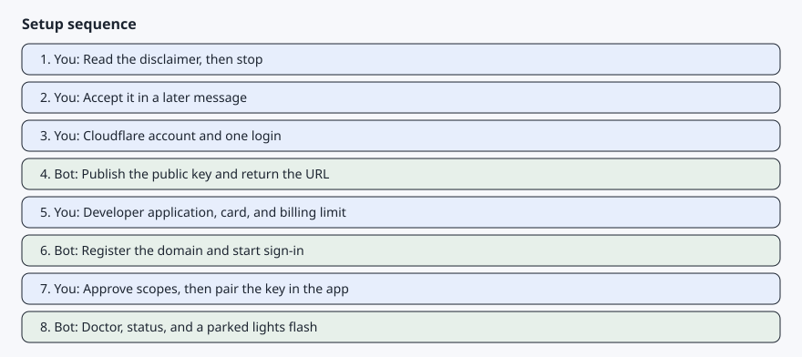
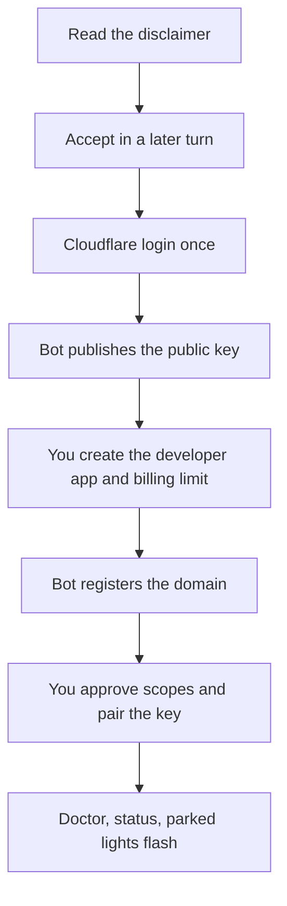

# Before you start

[Back to the README](../README.md)

AgentDrive connects a car you own to an assistant you already use. This page is the checklist. Do not skip a row because a later step will stop on it.

## Checklist

Each item has its own page: what to do, the result you should see, errors people hit, and a prompt you can hand the bot when the bot can help.

| Item | Why it is needed | Cost | Who |
| --- | --- | --- | --- |
| [Vehicle account](prerequisites/vehicle-account.md) | The getting-started guide requires a vehicle account with a verified email and multi-factor authentication, and only that account can approve the car. | No fee from AgentDrive. | You |
| [A car that can take a virtual key](prerequisites/vehicle-compatibility.md) | Signed commands need compatible hardware, firmware, and an enrolled key. | No extra fee. | You, then the bot reads fleet status |
| [A computer the assistant can use](prerequisites/computer.md) | The private key, `tesla-control`, and doctor run here. | Your machine. Tools are free. | You provide it. The bot checks it. |
| [An assistant](prerequisites/assistant.md) | Someone has to run the steps and stop when a human approval is required. | Your existing assistant plan, if any. | You choose it |
| [A developer application](prerequisites/developer-app.md) | Tesla issues the client id and secret only after an application exists. | No AgentDrive fee. API use is billed later. | You |
| [A payment method and a billing limit](prerequisites/billing.md) | Tesla disables an application that has no payment method or that passes its limit. The default limit is 0. | A card you control. A $10 monthly discount is what Tesla currently publishes. | You |
| [A free Cloudflare account](prerequisites/public-key-host.md) | The public key has to be fetched over HTTPS from a hostname you register. | Free plan. No domain purchase. | You log in once. The bot publishes. |
| [Key pairing in the official app](prerequisites/virtual-key.md) | The car ignores signed commands until the key is on its list. | Free. | You, on your phone |
| [Time](prerequisites/time.md) | Approvals cannot be batched into the bot's turn. | About an hour of your time if the application is accepted immediately. | You and the bot, in turns |

## The path, one line each

1. Read the disclaimer and the security file, then stop. Outcome: nothing is installed yet. [Install and safety](01-install-and-safety.md).
2. Accept in a later message. Outcome: the installer is allowed to run. [Install and safety](01-install-and-safety.md).
3. Clear the checklist. Outcome: you can name who does each remaining step. This page.
4. Install. Outcome: `python -m core doctor` can start. [Install and safety](01-install-and-safety.md).
5. Approve Cloudflare login once. Outcome: wrangler is allowed to upload. [Public key host](prerequisites/public-key-host.md).
6. The bot publishes the key. Outcome: the well-known URL returns a public key. [Host the public key](02-host-the-public-key.md).
7. Create the developer application. Outcome: the pages.dev hostname is an allowed origin and the secret is in a file. [Developer application](03-developer-app.md).
8. Add a card and a billing limit. Outcome: the limit is above 0 and you know the cap. [Billing](prerequisites/billing.md).
9. Register the domain and start sign-in. Outcome: a browser link for you, not a token in chat. [Sign-in and pairing](04-sign-in-and-pairing.md).
10. Finish sign-in yourself. Outcome: a refresh token is stored locally. [Tokens](05-tokens.md).
11. Pair the key in the app. Outcome: the locks screen lists it. [Virtual key](prerequisites/virtual-key.md).
12. Run doctor. Outcome: four checks pass, or the failing one says why. [Troubleshooting](09-troubleshooting.md).
13. Ask for status, then flash the lights while parked. Outcome: the car answers and the lights flash once. [Queries and commands](06-queries-and-commands.md) and [Skills](08-skills.md).
14. Leave the morning briefing off until you want it. Outcome: silence unless you need to act. [Assistants](07-assistants.md).
