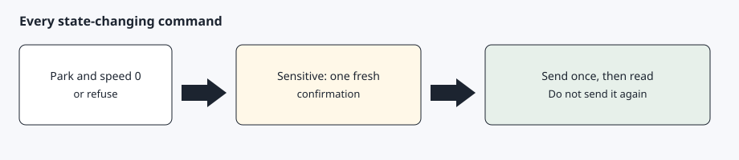

# Install and safety

[Back to the checklist](00-before-you-start.md)

A beginner pastes the short prompt in [How to start](../README.md#how-to-start). That prompt sends the AI agent to [Before you start](00-before-you-start.md), where the full install prompt lives. This page is what the AI agent runs after that person accepts in a later message.

Installation is two turns. The first turn shows the documents. A later turn records your acceptance. The installer will not create that acceptance for you.



## Step 1 — Read both documents

Read [DISCLAIMER.md](../DISCLAIMER.md) and [SECURITY.md](../SECURITY.md) in full. They say the project is experimental, that you bear the consequences, and that sensitive commands need a fresh confirmation that a schedule cannot skip.

## Step 2 — Accept later

From the repository root (so Python can find the core package):

```bash
PYTHONPATH=. python3 -m core gate-present --turn-id 1
PYTHONPATH=. python3 -m core gate-accept --turn-id 2 --statement "I have read, understood, and accept the AgentDrive disclaimer and security reminder"
bash setup/install.sh
```

Use a different `--turn-id` for each chat message (for example 1 when showing the docs, 2 when recording acceptance). Same-turn acceptance is rejected. `setup/install.sh` checks the stamp, detects the host adapter, then creates `.venv`.

Override a wrong detection with `bash setup/install.sh --adapter template`.

## Step 3 — What the safety gate will refuse

A state-changing command is sent only when the shift state is Park and the speed is 0. Unlock, remote start, the front trunk, the rear trunk, sentry off, and charging changes each need an explicit confirmation for that action. The next action needs a new one. A schedule cannot supply it.

## After install — health check

On install, the AI agent schedules `agentdrive check --json` every 30 minutes. The check is read-only and does not wake a sleeping car. Notify only when the exit code is 1. Exit 0 means nothing new, including when the car is asleep and when the same alerts are still active. The same alert stays quiet until it clears and later returns. Do not schedule unlock or a charging change. AgentDrive does not run that job and does not install cron. The morning usage briefing stays the separate daily job described below.

## After install — daily report

AgentDrive does not run in the background. After `setup/install.sh` finishes, the AI agent reads `agentdrive report-schedule`. The default is 07:30 local time and enabled. The AI agent creates one daily job at that time, runs `agentdrive history due`, and sends that usage briefing. On Monday it is the previous week, on the 1st the previous month, and on 1 January it is the previous year. `agentdrive report` is still the live snapshot when you want the car's current status, including the skip line when the car is not online. A later request to change the time or turn the briefing off is `agentdrive report-schedule set HH:MM`, `disable`, or `enable`. The AI agent then updates its job. The command only writes private config under `$AGENTDRIVE_HOME`. It does not edit the AI agent's routine and it does not install cron.

## Update an existing install

`agentdrive update` brings the checkout in line with the latest `main` and re-runs the install steps, including the `tesla-control` build. It does not modify private configuration under `$AGENTDRIVE_HOME`: tokens, keys, client credentials, `host.yaml`, or vehicle files. `setup/install.sh --update` is the same tooling step without the adapter detection that writes `host.yaml`.

## Expected result

`python -m core gate-check` prints that install is allowed, and `setup/install.sh` finishes with a virtual environment. `$AGENTDRIVE_HOME/host.yaml` names the adapter.
