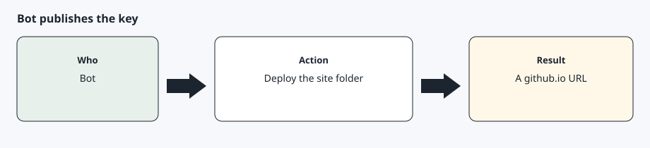

# Host the public key

[Back to the checklist](00-before-you-start.md)

You need a GitHub account. You do not buy a domain. After you approve `gh auth login` once, the assistant publishes the key. The click-by-click version is [Public-key host](prerequisites/public-key-host.md).



## What you do

Approve `gh auth login` once when the assistant asks. Then stop.

## What the assistant does

```text
1. I have a GitHub account. Run gh auth login if gh auth status is not already logged in, and wait while I approve it once.
2. Read docs/prerequisites/public-key-host.md.
3. Generate a P-256 (prime256v1) key pair, the curve Tesla requires, in ~/.config/agentdrive (or $AGENTDRIVE_HOME). Set mode 600 on the private key (readable only by your user; run chmod 600 on the file). Do not print the private key and do not put it in the git repository.
4. Publish only the public key with setup/publish-public-key.sh --owner <username> --public-key pointing at the public key. The repository must be <username>.github.io so the key is at the domain root. If that repository already has a site, add the key file and .nojekyll only. Do not replace other files.
5. Curl the well-known URL. Run python -m core doctor for that URL. Reply with the github.io URL and the HTTP status.
6. Stop. Do not create a developer application in this turn.
```

The published URL looks like `https://<username>.github.io/.well-known/appspecific/com.tesla.3p.public-key.pem`.

A project subpath does not work. Tesla fetches the key at the domain root. The repository includes `.nojekyll` so GitHub Pages serves `.well-known`. Any HTTPS host at a domain root also works, for example a custom domain.

## Whether Tesla accepts that hostname

Tesla's partner docs require a lowercase domain that shares a root with an allowed origin. Their example is `123.abc.com` alongside an origin of `www.abc.com`. The getting-started page lists "Domain name is invalid" as an automatic rejection. Use the hostname that serves the key, at the domain root, and treat the portal's answer as the verdict.

## Expected result

`curl` prints a public key and doctor passes the public-key check. The token check stays failed until sign-in.
