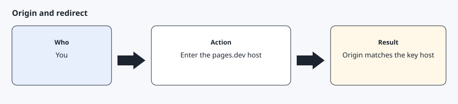

# Developer application

[Back to the checklist](00-before-you-start.md)

The full form steps are in [Developer application](prerequisites/developer-app.md). Billing is in [Payment method and billing limit](prerequisites/billing.md).

## What you type

1. Sign in at <https://developer.tesla.com> with the vehicle account.
2. Create an application with a unique English name and a description of personal use of your own car. Grant `openid`, `offline_access`, `user_data`, `vehicle_device_data`, `vehicle_location`, `vehicle_cmds`, and `vehicle_charging_cmds`. `vehicle_location` is required for a location read. `vehicle_charging_cmds` is required for official charging history and invoices.
3. Set the allowed origin to the bare hostname, such as `your-username.github.io`.
4. Set the redirect to `https://your-username.github.io/callback`.
5. Save the client id and client secret into `~/.config/agentdrive/client.json` (or `$AGENTDRIVE_HOME/client.json`) with keys `client_id` and `client_secret`, mode 0600, or into mode 0600 files under `~/.config/agentdrive/secrets/` (or `$AGENTDRIVE_HOME/secrets/`). The command line also reads `AGENTDRIVE_CLIENT_ID` and `AGENTDRIVE_CLIENT_SECRET`. Do not paste the secret into chat. A secret can contain `&`; the token request is form-encoded.
6. On the billing page, use Manage Payment and Update Limit. Tesla disables an application with no payment method, and the limit starts at 0. Usage is pay-per-use. Status codes 500 and above are not billed. The published monthly discount for individual developers is $10. Confirm the live page before you rely on that figure, and set a limit you can accept.

## Expected result

The dashboard shows the application, the origin matches the public-key host, and the billing limit is above 0.
