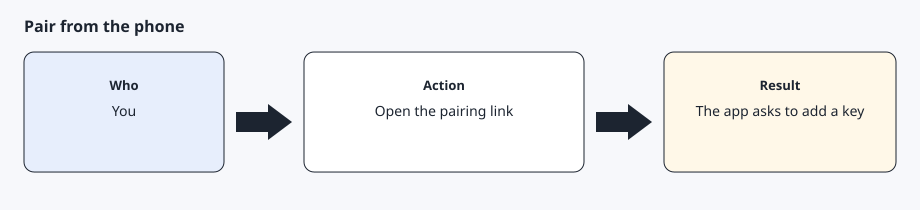

# Sign-in and pairing

[Back to the checklist](00-before-you-start.md)

Partner registration tells Tesla to fetch the public key. Owner sign-in is a separate browser step. Pairing is a phone step. Details are in [Pair the key](prerequisites/virtual-key.md).

## Order

1. The AI agent requests a partner token and calls the partner registration endpoint for your region (`na` or `eu`) with the github.io hostname. Register the region you actually use. Tesla says to repeat registration for each region you operate in.
2. The AI agent gives you an authorize URL. Open it in your own browser. Approve the scopes. Save the returned address in a local file. Do not paste the code into chat.
3. The AI agent exchanges the code and stores the tokens.
4. Open `https://tesla.com/_ak/<your-hostname>` in the phone's own browser, not an in-app browser, with the Tesla app installed, while you are near the car. Approve the key there. An example is `https://tesla.com/_ak/your-username.github.io` (the hostname you published).

After you approve the scopes, the browser opens the redirect URI. A page that says Not found is expected. The authorization code is in the address bar. Save that address in a mode 600 file. Do not paste it into chat.

Pairing can be checked with `POST /api/1/vehicles/fleet_status` and a JSON body `{"vins":["<vin>"]}`. `unpaired_vins` still needs the phone step. `key_paired_vins` means the key is on the account. Mask the VIN. Do not print the access token. Details are in [Troubleshooting](09-troubleshooting.md).

The authorize URL and the fleet host come from `config/regions.yaml`.

## Expected result

Partner registration succeeds, a token file exists under the home directory, and the car's locks screen lists the key.
