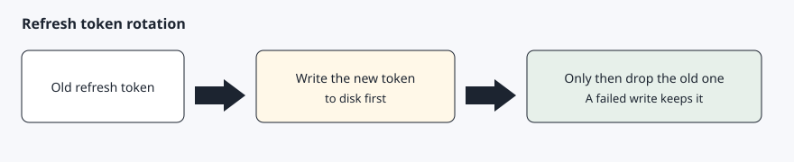

# Tokens

[Back to the checklist](00-before-you-start.md)

The access token lasts 8 hours (`expires_in` of 28800). The refresh token lasts about 90 days and rotates. AgentDrive reads the `exp` claim inside the access token and refreshes when fewer than 30 minutes remain. The refresh is wrapped in an exclusive lock file, `.refresh.lock`, mode 0600, next to the token file, so two processes cannot rotate the same refresh token at once. After the lock is taken the file is read again, and a process that waited uses the token the other process just saved.

Each refresh normally returns a new refresh token. AgentDrive writes that new record with `os.replace`, mode 0600, and only then drops the previous value from memory. If the write fails, the old file is left in place. If the response has a new access token but no refresh token, the previous refresh token is kept and the new access token is still saved. Its recorded refresh expiry is not extended.

When the refresh token itself is no longer in date, the next call stops and asks you to sign in again. It does not keep retrying a dead token.

The token file is mode 600. It is covered by `.gitignore`. Doctor reports whether the access token is still inside its lifetime or only the refresh token is. A token that is still valid, but inside the 30 minute window, is refreshed on the next command.

The token request is form-encoded. See [Troubleshooting](09-troubleshooting.md) if a hand-written `curl -d` returns `unauthorized_client`.

`agentdrive refresh` forces a rotation and prints that the tokens were saved. It does not print the tokens.

## Expected result

A later command refreshes on its own, and `host.yaml` is not where the token lives. Tokens stay in the token file.
