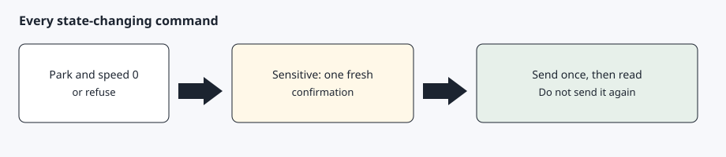

# Queries and commands

[Back to the checklist](00-before-you-start.md)



Reads use the Fleet API: the vehicle list, `vehicle_data`, and wake. Location on firmware 2023.38 and later needs the `location_data` endpoint and the `vehicle_location` scope. `status` and `check` do not request that endpoint. `where` requests it only when the vehicle list already says the car is online. Coordinates are not copied into assistant memory.

`agentdrive status` reads charge, climate, and vehicle state, including tyre pressures and TPMS warnings. If the vehicle list says the car is asleep, status sends one wake and then polls for up to 45 seconds. The VIN is masked. Tokens are not printed. When the account has more than one vehicle, set `AGENTDRIVE_VIN` to choose one. Otherwise the first vehicle on the account is used.

`agentdrive check` is the read-only health check for a schedule. It reads the vehicle list first and does not wake a sleeping car. If the car is not online, the command skips, prints that it skipped, and exits 0. If the car is online it reports actionable alerts and exits 1: a TPMS warning, a tyre below the configured bar threshold, a low battery that is not charging, the car unlocked or open while parked, or a charge error. `--json` prints a short object for a bot. Thresholds come from `--tyre-threshold`, `--battery-threshold`, or the `tyre_pressure_bar` and `low_battery_percent` habits in the profile. The default tyre line is 2.5 bar and the default battery line is 30 percent. The check does not request location.

`agentdrive where` is a read-only coarse area. It reads the vehicle list first. If the car is asleep or offline, it skips with the same kind of message as `check`, does not wake the car, and exits 0. If the car is already online, it calls `vehicle_data` with `endpoints=location_data` only.

Before that point leaves the process, latitude and longitude are rounded to two decimal places, about 1 km. The command sends that rounded point to OpenStreetMap Nominatim for one reverse lookup at zoom 14, with the `AgentDrive/<version>` User-Agent. It does not retry, and it does not send the precise point. Nominatim's usage policy allows this kind of light use and asks callers not to bulk-geocode. Place names are OpenStreetMap data.

The command prints a suburb or locality, a state or region, and a country. The text labels are `suburb`, `region`, and `country`. `suburb` is the suburb when Nominatim has one, and otherwise a neighbourhood, locality, village, town, or city. `--json` prints those three fields. Stdout, JSON, and errors do not contain coordinates. If the lookup fails, the command prints `area unavailable` and exits 1.

A location read needs the official `vehicle_location` scope. The owner sign-in scope list is `openid`, `offline_access`, `user_data`, `vehicle_device_data`, `vehicle_location`, and `vehicle_cmds`. If the token lacks `vehicle_location`, or the firmware refuses the read until that scope is granted, the command tells you to re-authorize and include `vehicle_location`, and it exits 1. Sign in again so the new token carries that scope. `status` and `check` stay free of location.

Commands:

| Command | What it sends | Confirmation |
| --- | --- | --- |
| `where` | no signed command; one `location_data` read when the car is already online | no |
| `wake` | signed `wake` | no |
| `flash` | signed `flash-lights` | no |
| `honk` | signed `honk` | no |
| `lock` | signed `lock` | no |
| `unlock` | signed `unlock` | yes, one time |
| `climate-on`, `climate-off` | signed climate command | no |
| `set-temp <C>` | signed `climate-set-temp` | no, and only 15 to 28 C |
| `charge-start`, `charge-stop` | signed charging command | yes, one time |
| `charge-limit <percent>` | signed `charging-set-limit` | yes, one time, and only 50 to 100 |

Unlock and every charging change go through the existing confirmation layer. A schedule cannot confirm them. State-changing commands are sent only in Park at speed 0, then read back once. Trunk, frunk, and remote start are planned on that same gate. See [Next](../README.md#next).

Signed commands run `tesla-control` with `TESLA_TOKEN_FILE`, `TESLA_KEY_FILE`, and `TESLA_VIN` set in the environment. Those names are what the tool requires. The access token is written to a mode 0600 file and deleted in a `finally` block. It is never placed on the argument list. The tool is invoked once. If it fails, it is not launched again until a read shows whether the car already changed.

`agentdrive update` fast-forwards the checkout from `main`, or downloads that branch when the tree is not a git checkout, then re-runs the install steps. It does not modify tokens, keys, client credentials, `host.yaml`, or vehicle files under `$AGENTDRIVE_HOME`.

```bash
agentdrive check
agentdrive where
agentdrive update
```

`agentdrive status` does not request location. The client refuses the business-only charging sessions route. Nearby charging reads keep location and stall counts. Further commands we intend to add are listed under [Next](../README.md#next).

## Expected result

A status question returns a short readout with tyre pressures, no coordinates, and a masked VIN. `agentdrive where` returns a suburb, region, and country, or says that it skipped when the car is asleep. A parked lights flash runs once and is followed by another read. A sleeping car makes `agentdrive check` and `agentdrive where` exit 0 without a wake.
