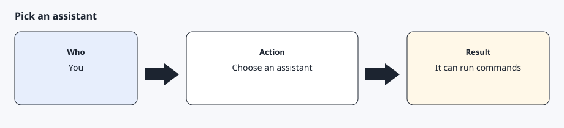

# Assistants

[Back to the checklist](00-before-you-start.md)



## Host environment variables

The installer and `python -m core adapter` look at the process environment and pick the host. If both hosts match, nothing is written and the command asks you to choose. Set one yourself with `--adapter grokbot`, `--adapter muse`, `--adapter template`, or `--adapter unknown`, or with `AGENTDRIVE_ADAPTER`. A saved file with `source: override` stays in place until you pass `--redetect`.

| Name | When it is used | What it does now |
| --- | --- | --- |
| `grokbot` | Detected from `GROK_BOT`, `GROKBOT`, `GROK_BOT_HOME`, `GROK_BOT_SESSION`, or `CURSOR_AGENT` | Supported — basic real-car commands tried on a vehicle. Working file-backed adapter. |
| `muse` | Detected from `MUSE_BOT`, `MUSE_HOME`, `MUSE_SESSION`, or `MUSE_AGENT` | Supported — basic real-car commands tried on a vehicle. Working file-backed adapter. |
| `unknown` | No host signal | The template adapter runs |

Grok Bot and Muse were used for basic real-car commands. That trial does not cover every command in this repository.

Detection runs from `setup/install.sh` and from `python -m core adapter`. Prefer `$AGENTDRIVE_HOME/host.yaml` (written by the installer). Only copy `config/host.example.yaml` to `config/host.yaml` for a repo-local override you do not commit. A conflict does not guess: the command prints both signal lists and exits until you pass `--adapter`. `AGENTDRIVE_ADAPTER` and a `source: override` file also win. `--redetect` drops a saved override and looks again.

```bash
python -m core adapter show
python -m core adapter --adapter template show
bash setup/install.sh
```

Copy `adapters/template.py` for a host that is not listed. The same five operations apply: schedule, memory, confirm, secrets, and notify. Notifications stay silent unless you need to act. A schedule cannot store a confirmation.

## Health check by default

Installing an assistant includes this instruction: set up a recurring health check by default. The routine runs `agentdrive check --json` every few hours. It is read-only. It reads the vehicle list first and does not wake a sleeping car. Exit 0 means there is nothing to do, including when the car is asleep, so the assistant stays quiet. Exit 1 means an alert (tyre pressure, TPMS warning, low battery while not charging, unlocked or open while parked, or a charge error). Notify only on exit 1. `agentdrive adapter install` prints the same note. The config home and the private-key path work on Windows as well as macOS and Linux.

```text
Schedule a routine named health-check that runs `agentdrive check --json` every few hours. Notify me only when the exit code is 1. Do not wake the car from that routine. Do not schedule unlock or a charging change.
```

## Daily vehicle report by default

The daily report is a second job, separate from the health check. The health check stays quiet unless it exits 1. The daily report is sent every time.

The default is 07:30 in the local timezone, and the report is enabled. `agentdrive report-schedule` prints that. The time is stored in `$AGENTDRIVE_HOME/runtime.yaml` under `report_schedule` when you change it. With no `report_schedule` key, the default above is what the command shows.

After install, the assistant creates one daily job at the configured time. The job runs `agentdrive report`, and the assistant sends the printed briefing to the user, including the skip line when the vehicle is not online. The command is read-only. It does not wake the car. A timeout or HTTP 408 is a skip, the same as a car that is already asleep or offline.

When you ask for a different time, the assistant runs `agentdrive report-schedule set HH:MM` and moves the job to that time. When you ask to turn the report off, the assistant runs `agentdrive report-schedule disable` and removes the job. `agentdrive report-schedule enable` turns it back on. AgentDrive does not update the job itself. The same steps apply to Grok Bot, Muse, and any agent that can run shell commands.

A host that uses cron can copy the example line printed by `agentdrive report-schedule`. AgentDrive does not install that line or a systemd timer. This is the recommended setup. It is not zero-setup: something outside AgentDrive has to run the command.

```text
Read `agentdrive report-schedule`. If it is enabled, create a daily job at that local time that runs `agentdrive report` and send me the output every day. If I change the time or turn the report off, update the job to match the command. Do not wake the car from that job.
```

## Using more than one assistant

Most people run one assistant. Two assistants can share one private key that is already paired with the car. Do not enroll a second key for that case.

Each agent has its own OAuth token. The token file rotates when it is refreshed, so a second copy goes stale, and two writers can invalidate each other. Keep one token file and one writer for each agent.

The key file is readable by both. Every agent that can read the private key can sign commands, together with a valid token, inside the scopes you approved. Keep one copy, limited to your user. A second copy is a second secret.

Point `AGENTDRIVE_KEY_FILE`, or `key_file` in `$AGENTDRIVE_HOME/runtime.yaml`, at that key. Point `AGENTDRIVE_TOKEN_FILE`, or `token_file` in the same file, at that agent's own token file. See `config/runtime.example.yaml`.

## Prompt you can give the bot

```text
Run python -m core adapter show and tell me the adapter name, whether it was detected or overridden, and which environment variables it used. If it says ambiguous, stop and ask me which adapter to store. Do not print secrets.
```
