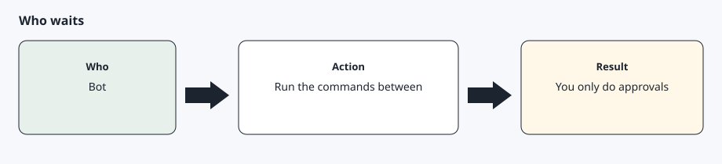

# Skills

[Back to the checklist](00-before-you-start.md)

Phase 1 runs four skills:

- **Status** answers a question you just asked. It does not push a notification and it does not include coordinates or a VIN.
- **Flash lights** requires Park and speed 0, sends one signed command, and reads the car again.
- **Climate on or off** uses the same park rule and checks the climate flag afterward.
- **Morning briefing** looks at lock, sentry, battery against your habit, and tire warnings. It speaks only when one of those needs you. Otherwise it stays silent.
- **`agentdrive check`** is the recurring health check. It does not wake a sleeping car. On a Grok Bot or Muse install, set that routine up by default and notify only when it exits 1. See [Assistants](07-assistants.md).

These are stubs with a TODO for Phase 2: onboarding, trip advisor, charging tips, and news watch. News watch, when it exists, is still supposed to stay quiet unless you need to act.

Habits and suburb-level places live in the profile file. Copy `config/profile.example.yaml` outside the repository before you fill it in. Do not put a street, a VIN, a token, or a live coordinate in it.

## Expected result

A direct status question gets a sentence back. A scheduled briefing sends nothing when the car is locked, sentry is on, the battery is above your line, and no tire warning is present.
