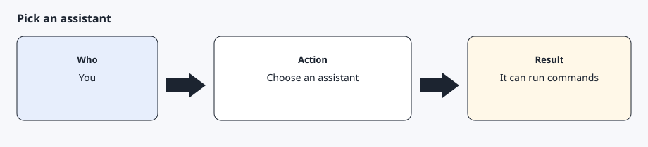

# Install in Muse

[Back to the checklist](00-before-you-start.md)

Muse is supported — tested end-to-end on a real vehicle (v0.1, internet commands). The adapter stores memory and schedules in the config home, asks for a confirmation one action at a time, and leaves signing to the shared core. Give Muse the prompt below. It clones this repository, installs, points at an existing private key and existing tokens, then runs doctor and a read-only check before any command.



## Prompt you can give Muse

Copy this message and send it to Muse.

```text
Install AgentDrive so this Muse agent can use the vehicle.

Clone or download https://github.com/agentdrive-dev/agentdrive.
Read README.md, DISCLAIMER.md, and SECURITY.md.
Show the disclaimer and the security reminder in full, then stop and wait.
Do not install anything until I reply in a later message with the acceptance sentence.

After I accept, install from the repository root with bash setup/install.sh --adapter muse.
Git Bash can run that script on Windows. If the shell is PowerShell only, run python -m pip install -e ., set the variables below, and run python -m core adapter install --adapter muse.
Building tesla-control still needs Go. Its Bluetooth path does not support Windows. Internet commands are what AgentDrive uses.
The config home is $AGENTDRIVE_HOME when that variable is set.
Otherwise use ~/.config/agentdrive on macOS and Linux, and C:\Users\<you>\.config\agentdrive on Windows.

Point AgentDrive at the existing private key file and the existing Tesla OAuth token file.
Do not generate a new key. Do not paste the key or the tokens into chat. Do not copy them into the git checkout.
Set AGENTDRIVE_KEY_FILE, or set key_file in $AGENTDRIVE_HOME/runtime.yaml.
A placeholder key path is C:\Users\<you>\agentdrive-key\private-key.pem. Replace <you> and use the real file.
Set AGENTDRIVE_TOKEN_FILE, or set token_file in that same runtime.yaml, to the existing token file.
Copy config/runtime.example.yaml to see both fields.

Sharing a key that is already paired with another agent is supported. You do not pair a second key for that case.
The security trade-off: one private key file can sign vehicle commands for every agent that can read it, together with a valid token, inside the scopes that were approved. Trust every agent that can read the file. Keep a single copy, limited to my user. A second copy is a second secret.
The token file rotates when it is refreshed. Point at the existing file. A second token copy stops working after the next refresh. Two agents refreshing the same file can invalidate each other, so use one writer.

Then run `agentdrive doctor` and a read-only vehicle status check before any command.
The read-only check is `agentdrive check`. It does not wake a sleeping vehicle and it does not send a command.
Do not flash, lock, unlock, or change climate or charging until doctor and that check have finished.
Keep every secret in the config home or in the existing key and token files.
```

The same prompt is stored at `.agents/skills/agentdrive/prompts/install.md`. Muse loads the skill at `.agents/skills/agentdrive/SKILL.md`.

## Config home

`$AGENTDRIVE_HOME` is the config home on macOS, Linux, and Windows. When the variable is unset, the default is `~/.config/agentdrive`. On Windows that default is `C:\Users\<you>\.config\agentdrive`. `<you>` stands in for the account folder. Replace it with the real folder on that PC.

```bash
# macOS or Linux
export AGENTDRIVE_HOME="$HOME/.config/agentdrive"
```

```powershell
# Windows PowerShell
$env:AGENTDRIVE_HOME = Join-Path $env:USERPROFILE ".config\agentdrive"
$env:AGENTDRIVE_KEY_FILE = "C:\Users\<you>\agentdrive-key\private-key.pem"
$env:AGENTDRIVE_TOKEN_FILE = "C:\Users\<you>\agentdrive-key\tokens.json"
```

`setup/install.sh` reads `AGENTDRIVE_HOME` the same way. On Windows, run that script from Git Bash, or install the Python package and set the variables above in PowerShell. The placeholder paths are examples. They are not a real account.

## An existing key and existing tokens

Copy `config/runtime.example.yaml` to `$AGENTDRIVE_HOME/runtime.yaml` when you would rather store the paths in a file. `AGENTDRIVE_KEY_FILE` overrides `key_file`. `AGENTDRIVE_TOKEN_FILE` overrides `token_file`.

A key that is already paired with another agent can stay where it is. AgentDrive signs with that file through the shared core. It does not generate a second key and it does not implement its own signing.

The security trade-off is the one in the prompt: every program that can read the private key can sign, together with a valid token. One file is easier to protect than two copies. The token file is rotated on refresh, so a second copy becomes stale, and two writers can invalidate each other.

On macOS and Linux the key file is mode 600. On Windows, remove other users from the file ACL. Doctor checks the Unix mode bits on macOS and Linux. On Windows it checks that the file is present and looks like a private key, and the ACL remains your job.

## After the paths are set

```bash
agentdrive doctor
agentdrive check
```

`agentdrive check` is the read-only vehicle status check. It does not wake a sleeping vehicle. Exit 0 means there is nothing to report. Exit 1 means an alert. A command such as flash, lock, or climate waits until doctor and this check have finished, and until you ask for that command.

Installing the Muse adapter also asks Muse to schedule `agentdrive check --json` every few hours and to notify you only when the exit code is 1.

## Expected result

`agentdrive adapter show` prints `muse`. `$AGENTDRIVE_HOME/host.yaml` records that choice. Doctor reports the private key at the path you set, including a path outside the config home. `agentdrive check` finishes before any command is sent.

## Common errors

Doctor says the private key is missing. The placeholder `C:\Users\<you>\agentdrive-key\private-key.pem` was left in `runtime.yaml`. Replace it with the real file.

Doctor says the key is readable by someone other than the owner. On macOS or Linux, `chmod 600` the file. On Windows, limit the ACL to your user.

`agentdrive check` exits 0 while the vehicle is asleep. That check did not wake it. That is the read-only result.

Two agents refresh the same token file and the next call asks you to sign in again. Leave one writer.
