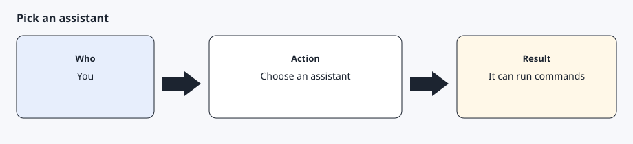
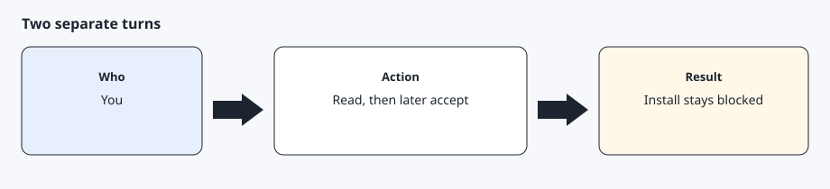
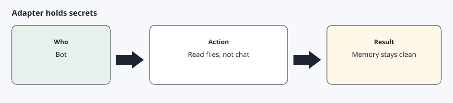
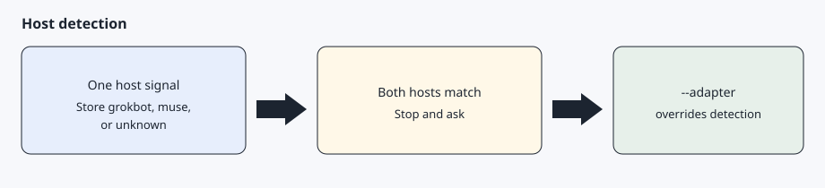

# An AI agent

[Back to the checklist](../00-before-you-start.md)

Works with Grok Bot, Muse, or any shell-capable AI agent.

The AI agent has to read these docs, run shell commands, store files on the machine, and wait when a step needs you. You choose the AI agent. AgentDrive does not add a fee on top of whatever that AI agent already costs. Everyone pastes the same prompt in [How to start](../../README.md#how-to-start).

## Step 1 — Choose an AI agent that can run commands



The AI agent follows these docs and runs commands on your computer. It can use `adapters/template.py` when it can call the same five operations: schedule, memory, confirm, secrets, and notify. If the AI agent can only chat, it can still walk you through the pages, but it cannot publish the key or refresh tokens by itself.

On install, set up a recurring health check by default. Schedule a routine that runs `agentdrive check --json` every few hours. The check is read-only and does not wake a sleeping car. Exit 0 means there is nothing to report, including when the vehicle is asleep. Exit 1 means an alert the owner should hear. Notify only when the exit code is 1. Do not put that check on a schedule that wakes the car, and do not schedule unlock or a charging change.

On install, also set up the morning history. Read `agentdrive report-schedule`. The default is 07:30 local time and enabled. Create one daily job at that time that runs `agentdrive history due` and send that briefing. On Monday it is the previous week, on the 1st the previous month, and on 1 January the previous year. `agentdrive report` is the live snapshot when the user wants the car's current status, including when the car is asleep. If the user asks for a different time or to turn the briefing off, update the stored schedule and update the job. AgentDrive does not run in the background. The same job is used for Grok Bot, Muse, and any other shell-capable AI agent.

## Step 2 — Use two turns for the disclaimer



The first message from the AI agent must be the full [disclaimer](../../DISCLAIMER.md) and the full [security file](../../SECURITY.md), then a stop. Your acceptance has to be a later message, in these words:

`I have read, understood, and accept the AgentDrive disclaimer and security reminder`

A vague reply does not count. The AI agent must not type that sentence for you in the same turn it showed the documents.

## Step 3 — Secrets go through the adapter, not through chat



The adapter reads `client-id`, `client-secret`, `vin`, and `redirect-uri` from files when a command needs them. It will not store those values in memory. A schedule cannot carry a confirmation, and a notification is sent only when you need to act.

## Step 4 — Let the installer detect the host



You do not pick an adapter by hand when the process already shows which host it is. `setup/install.sh` and `python -m core adapter` check the environment and write `$AGENTDRIVE_HOME/host.yaml`. If none match, the stored choice is `unknown` and runtime uses the template adapter. If two hosts match, the installer stops and asks you to pass `--adapter`. A value of `0`, `false`, or `no` does not count as a match.

Force a choice with `bash setup/install.sh --adapter template` or `AGENTDRIVE_ADAPTER`. Prefer `$AGENTDRIVE_HOME/host.yaml` (written by the installer). Only copy `config/host.example.yaml` to `config/host.yaml` for a repo-local override you do not commit. A file with `source: override` is kept until you pass `--redetect`. See `config/host.example.yaml`. The host names are listed in [AI agents](../07-assistants.md).

## Expected result

You know which AI agent will run the toolkit, it has shown you the disclaimer without installing anything, and you know the acceptance sentence is yours to send later.

## Common errors

The AI agent starts installing in the same message as the disclaimer. Stop it. Acceptance has not happened.

The AI agent asks you to paste a token or a private key into chat. Refuse. Point it at a mode 600 file instead.

Two AI agents share one car. They can share the private key that is already paired. Each AI agent still has its own OAuth token. See [Using more than one AI agent](../07-assistants.md#using-more-than-one-ai-agent).

## Prompt for the AI agent

Copy this only when you want the AI agent to do the part below. It must not invent approvals.

```text
Read DISCLAIMER.md and SECURITY.md and present both to me in full. Then stop. Do not install anything, do not create keys, and do not ask me for secrets in this message. Wait until I reply in a later message with the acceptance sentence.
```
