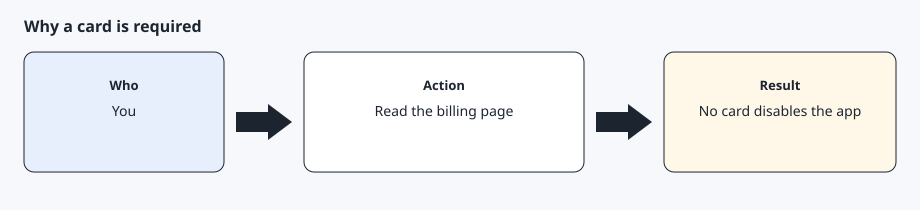
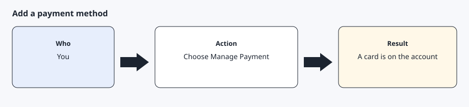
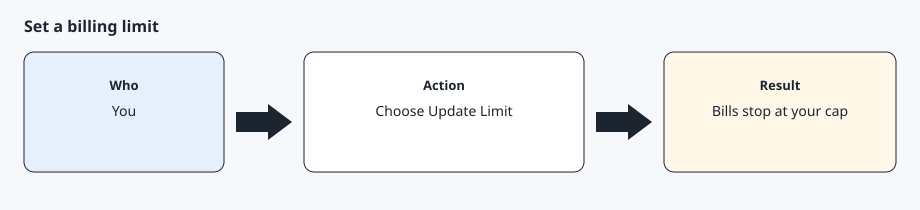
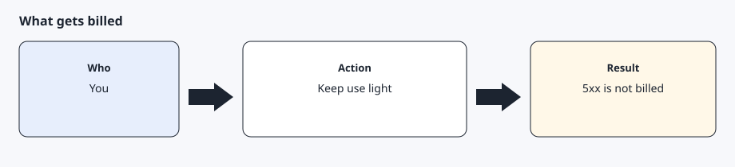

# Payment method and billing limit

[Back to the checklist](../00-before-you-start.md)

Tesla's billing page says Fleet API is pay-per-use. An application that exceeds its billing limit, or that has no payment method, is disabled. The limit starts at 0 and can be raised only after a payment method is added. Tesla recommends setting a limit. Status codes below 500 are billed. Status codes 500 and above are not billed. A monthly discount of $10 is published for individual developers and small applications. That figure is Tesla's current page, not a promise from this project. Read <https://developer.tesla.com/docs/fleet-api/billing-and-limits> before you rely on it.

You do this in the portal. The AI agent must not ask for the card number.

## Step 1 — Read why the card is required



Open the billing and usage page for the application. Tesla says that without a payment method the application is disabled, and that the default limit is 0. The note about a payment transition ending in February 2024 is in the past. Plan on adding a card before you depend on the connection.

## Step 2 — Add a payment method



On the billing and usage page, choose Manage Payment and add a card you control. Do not read the card number aloud to the AI agent or type it into chat.

## Step 3 — Set a billing limit above zero



Choose Update Limit and set a ceiling you are willing to hit. Tesla says usage can run slightly over the limit, and that pre-tax bills are capped at the limit. If the limit is hit, API access is suspended until you raise it or a new billing cycle starts. Pick a small limit for a single car and a health check every 30 minutes.

## Step 4 — Know what is billed



Wakes, data reads, and commands are billed. A 500-and-above response is not. The published $10 monthly discount may cover light personal use. It is per account, and Tesla can change it. This toolkit avoids polling loops for that reason. `agentdrive check` and `agentdrive where` do not wake a sleeping car, which keeps the call count down. The daily `agentdrive report` is one read when the AI agent runs it, and it does not wake a sleeping car either. `agentdrive charge-schedule show` does not wake a sleeping car.

## Expected result

The billing page shows a payment method and a limit above 0. You can point at the limit you chose. The card number was never sent to the AI agent.

## Common errors

The application suddenly stops answering. Check whether the limit was hit or the payment method was removed. Tesla disables the app in both cases.

The limit is still 0. Calls can be rejected even though the key and the token are fine. Raise the limit.

A bill is larger than you expected. Stop extra wakes and reads. Do not add a polling loop to "see if it gets cheaper."

## Prompt for the AI agent

Copy this only when you want the AI agent to do the part below. It must not invent approvals.

```text
Remind me to add a payment method and a billing limit on the Fleet API billing page. Tell me to use Manage Payment and Update Limit. Do not ask for my card number, and do not continue to vehicle commands until I tell you the limit is above 0.
```
