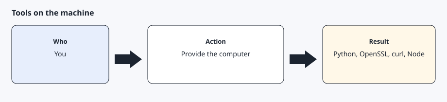
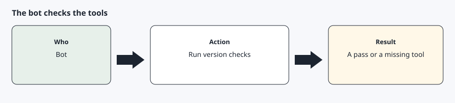
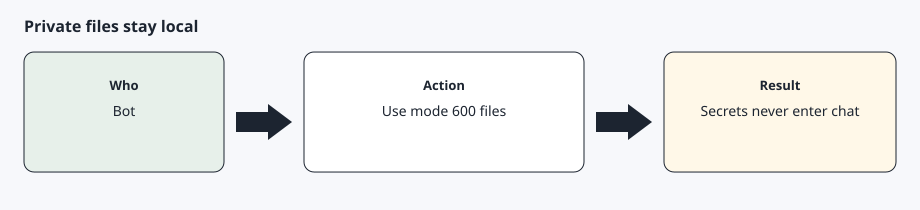

# A computer the assistant can use

[Back to the checklist](../00-before-you-start.md)

The private key, the token file, doctor, and `tesla-control` live on a computer the assistant can operate. A phone can approve sign-in and pairing. It cannot hold the private key for this toolkit.

You provide the machine. The bot checks the tools. Nothing here is a fee from AgentDrive. Python, OpenSSL, curl, Node.js, and the Go toolchain are free. Go is only needed if `tesla-control` is built from source.

## Step 1 — Provide a machine with the tools



The machine needs Python 3.11 or newer, OpenSSL, curl, and Node.js with npx. Node is used once, to publish the public key with wrangler. `tesla-control` comes from Tesla's vehicle-command project: <https://github.com/teslamotors/vehicle-command>. `setup/install.sh` clones that repository and runs `go build ./cmd/tesla-control`. Installing the module with Go's `@latest` selector fails because the upstream module uses replace directives, so the installer does not do that. The official tool does not support Windows for its Bluetooth path. Internet commands are what this toolkit uses.

## Step 2 — Let the bot check, not guess



Ask the bot to run `python3 --version`, `openssl version`, `curl --version`, `node --version`, and `tesla-control -h`. A missing tool should stop that step. The bot should install only what you agree to, in a later turn if the install is large.

## Step 3 — Keep secrets in a private folder



Use `~/.config/agentdrive` (or `AGENTDRIVE_HOME`). The private key file must be mode 600. The folder should be mode 700. The repository's `.gitignore` rejects key and token files. Do not copy them into the git checkout.

## Expected result

The four version commands succeed, `tesla-control -h` prints help, and `~/.config/agentdrive` exists with permissions limited to your user.

## Common errors

`python3 --version` is older than 3.11. Install a newer Python before `setup/install.sh`.

`npx` is missing. Install Node.js before the public-key step. The rest of the toolkit can wait.

`tesla-control` is not on `PATH`. Re-run `setup/install.sh` so it can clone the vehicle-command repository and build `./cmd/tesla-control`. The binary is placed in `$AGENTDRIVE_HOME/bin`. Do not substitute a random binary from a forum.

The private key was created inside the git repository. Move it to `AGENTDRIVE_HOME` and do not commit it.

## Bot prompt

Copy this only when you want the bot to do the part below. It must not invent approvals.

```text
Check this machine for AgentDrive. Run python3 --version, openssl version, curl --version, node --version, and tesla-control -h. Tell me which ones are missing. Do not generate a key, do not log in anywhere, and do not print any file under ~/.config/agentdrive.
```
