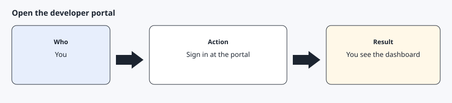
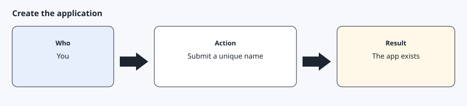
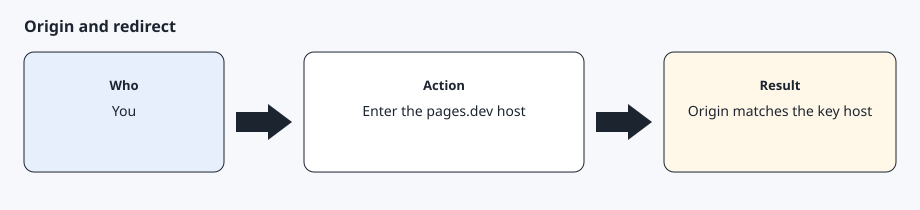

# Developer application

[Back to the checklist](../00-before-you-start.md)

Tesla's getting-started page says to create an application and to provide the details the form asks for, including legal business details, a name, a description, and a purpose. A duplicate application name is rejected automatically. The form can also reject a domain as invalid. Creating the application is not a charge from AgentDrive. API use is billed on the billing page.

You submit the form. The bot may draft the description. It must not see the client secret.

## Step 1 — Sign in to the developer portal



Open <https://developer.tesla.com> and sign in with the vehicle account. Complete the authentication code in the browser. When the dashboard is visible, you are in the right place.

## Step 2 — Create the application



Create an application with a unique English name. Describe personal use of your own vehicle: occasional reads and occasional commands, not a service for other people. Select the scopes you actually want. The default set for this toolkit is vehicle information, vehicle location, and vehicle commands, plus the sign-in scopes the portal pairs with them. Add charging management only if you want charging changes later. If the portal's fields do not match a private individual, stop and read the form. Do not invent a company.

## Step 3 — Set the origin and the redirect to the public-key hostname



Use the hostname the bot already published, such as `your-project.pages.dev`. Tesla's partner docs say the registered domain must be lowercase and must share a root with an allowed origin. Their example is `123.abc.com` with an origin of `www.abc.com`. Put the hostname, with no path and no trailing slash, in the allowed origin. Put `https://your-project.pages.dev/callback` as the redirect. The static site includes that path so the browser can land somewhere after you approve.

## Step 4 — Store the client secret in a file


Copy the client id and the client secret from the portal into `~/.config/agentdrive/client.json` as `client_id` and `client_secret`, mode 0600. The command line reads that file, or `AGENTDRIVE_CLIENT_ID` and `AGENTDRIVE_CLIENT_SECRET` from the environment. The adapter can still read `secrets/client-id` and `secrets/client-secret` when those files are mode 0600. Also write `redirect-uri` with the exact redirect you registered. Do not paste the secret into chat, and do not regenerate it unless you mean to invalidate the old one. A secret can contain `&`. The toolkit encodes the token request so that character is not treated as another field.

## Expected result

The dashboard shows the application, the allowed origin is the pages.dev hostname, the redirect is the callback URL, and the secret exists only in the local file.

## Common errors

`Application name already exists`. Pick a different name and submit again. Do not change the description into something you do not mean.

`Domain name is invalid`. Tesla's setup page lists this as an automatic rejection. Read the domain caveat in the public-key guide before you try a string the portal has already refused.

The secret was pasted into chat. Treat it as exposed. Regenerate it in the portal, store the new value in the file, and do not repeat the old value.

## Bot prompt

Copy this only when you want the bot to do the part below. It must not invent approvals.

```text
Draft a short English description of a personal application that reads my own car and sends occasional commands. Do not submit the form. Do not ask me to paste the client secret. After I tell you the pages.dev hostname, tell me the exact allowed origin and redirect URI to type. Then stop.
```
