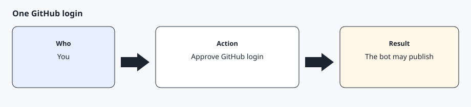
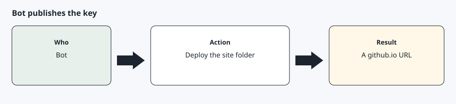
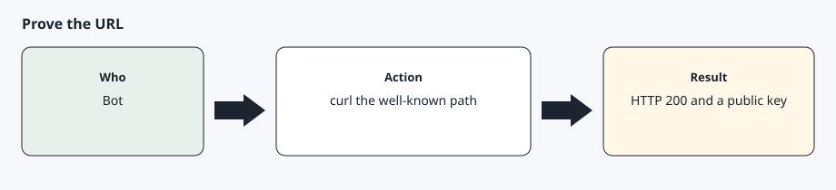
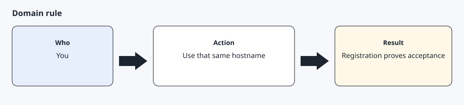

# Free public-key host

[Back to the checklist](../00-before-you-start.md)

You do not buy a domain. The bot publishes a static site on Cloudflare Pages at `https://<project>.pages.dev` after you sign up and approve `npx wrangler login` once. That hostname serves files from the root, so the key can live at the path Tesla fetches.

Tesla's partner documentation requires a lowercase domain that shares a root with an allowed origin, and a prime256v1 public key that stays publicly readable at `https://<domain>/.well-known/appspecific/com.tesla.3p.public-key.pem`. Their example of the root rule is `123.abc.com` with an allowed origin of `www.abc.com`. The getting-started page also lists "Domain name is invalid" as a reason an application can be rejected automatically.

Tesla does not publish an allow-list or a ban-list that names `pages.dev`. A shared `pages.dev` hostname is therefore not officially guaranteed. Register the exact hostname you deployed, use that same hostname as the partner domain, and treat the portal and the register call as the verdict. This guide does not offer a second host. If Tesla rejects the hostname, stop and report the error they returned.

The template includes an empty `.nojekyll` file so a host that hides dot-directories still publishes `.well-known`. Cloudflare Pages serves that directory either way. The publish script uploads a temporary copy, not the git checkout, and it refuses a file that contains a private key.

## Step 1 — Create a free Cloudflare account and log in once



Create a free account at <https://dash.cloudflare.com/sign-up>. Finish the checks Cloudflare shows. On the computer, run:

```bash
npx --yes wrangler login
```

Approve the browser prompt. When it finishes, `npx wrangler whoami` should show the account. That is the only login this host needs. Do not buy a domain.

## Step 2 — Let the bot create the key and publish the site



The bot generates a prime256v1 key pair in `~/.config/agentdrive`, mode 600 for the private key. It copies only the public key into a temporary folder laid out like `setup/public-key-site`, at `.well-known/appspecific/com.tesla.3p.public-key.pem`. It picks a lowercase project name that does not contain the word tesla, then runs:

```bash
bash setup/publish-public-key.sh --project <project> --public-key ~/.config/agentdrive/public-key.pem
```

The script runs `npx wrangler pages deploy` from that temporary folder and prints `https://<project>.pages.dev/.well-known/appspecific/com.tesla.3p.public-key.pem`.

## Step 3 — Check the URL before you leave the step



The same script curls the URL. You can repeat it:

```bash
curl -fsS "https://<project>.pages.dev/.well-known/appspecific/com.tesla.3p.public-key.pem"
```

The body must contain `BEGIN PUBLIC KEY` and must not contain a private key. Then run doctor. The token check will fail until sign-in. The public-key check should pass.

```bash
PYTHONPATH=. python3 -m core doctor --public-key-url "https://<project>.pages.dev/.well-known/appspecific/com.tesla.3p.public-key.pem" --secrets-dir ~/.config/agentdrive
```

## Step 4 — Use that hostname everywhere Tesla asks for a domain



The allowed origin, the redirect host, the partner registration domain, and the pairing link all use `your-project.pages.dev` with your real project name. Do not register a different host than the one that serves the key. If the portal says the domain is invalid, or partner registration fails, that is Tesla's answer about this shared hostname. Stop and keep the error text. Do not switch hosts inside this guide.

## Expected result

`curl` prints a public key from the pages.dev URL, doctor passes the public-key check, and you have the hostname written down for the developer application. The private key is only in `~/.config/agentdrive`.

## Common errors

`wrangler login` opens a browser and you are not signed in. Finish the Cloudflare account first, then run login again.

The project name contains `tesla` or is not lowercase. The script exits before upload. Pick another name.

curl returns 404. The file is not at the exact well-known path. Deploy again from the template layout. Do not rename the pem file.

The body contains a private key. Delete the deployment, rotate the key pair, and publish only the public half.

Partner registration or the application form says the domain is invalid. Tesla has not documented `pages.dev` as accepted. Report the error. This guide has no alternate host.

## Bot prompt

Copy this only when you want the bot to do the part below. It must not invent approvals.

```text
I have already created a Cloudflare account and finished npx wrangler login. Read docs/prerequisites/public-key-host.md. Generate a prime256v1 key pair in ~/.config/agentdrive with mode 600 on the private key. Do not print the private key and do not put it in the git repository. Publish only the public key with setup/publish-public-key.sh using a lowercase project name that does not contain tesla. Curl the well-known URL, run doctor for that URL, and reply with the pages.dev URL and the HTTP status. Stop. Do not create a developer application in this turn.
```
