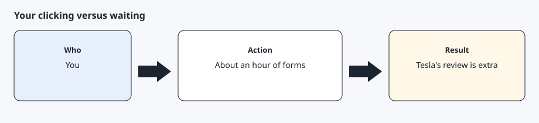
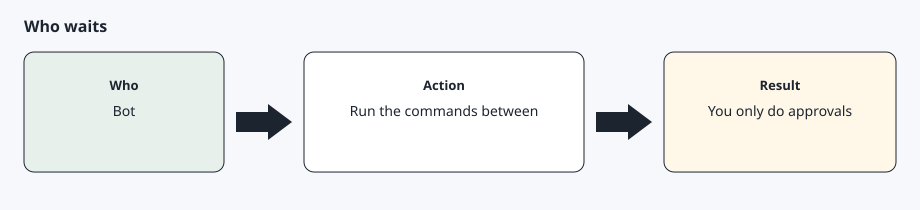

# How long this takes

[Back to the checklist](../00-before-you-start.md)

The human steps are the disclaimer, the Cloudflare approval, the developer form, the card, the billing limit, the browser sign-in, and the phone pairing. Together they are about an hour of clicking when every form is accepted on the first try.

Tesla does not publish a review time for the application. A duplicate name or an invalid domain is rejected automatically, and that rejection ends the hour until you fix it. The bot's commands sit between your approvals. They are not a reason to skip a turn.

## Step 1 — Plan on an hour of your own clicking



Set aside a sitting where you can reach the phone, the browser, and the card. Do not start the developer application if you cannot finish the billing limit in the same sitting. An application with no payment method is disabled under Tesla's current billing page.

## Step 2 — Let the bot run only the steps between approvals



A normal rhythm is: you approve, the bot works, the bot stops, you approve the next thing. Combining the disclaimer and the installer in one turn is the failure this project blocks. Combining key publication and a vehicle command in one turn is the same kind of rush. The sequence on the checklist page is the order.

## Expected result

You can point at which step you are on, and you are not trying to finish the card, the key, and a command in a single message.

## Common errors

The application is not accepted immediately. Stop. The wait is Tesla's. Do not create a second application with the same name.

You are tired of the forms and want the bot to click the portal for you. It should refuse the password, the card, and the pairing approval.

## Bot prompt

Copy this only when you want the bot to do the part below. It must not invent approvals.

```text
Tell me which AgentDrive setup step I am on, using docs/00-before-you-start.md. List only the next human approval and the next command you can run after that approval. Do not run the command yet.
```
