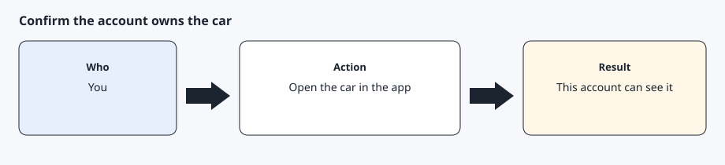
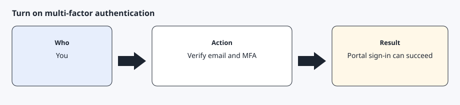
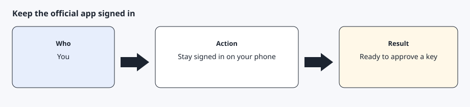

# Vehicle account

[Back to the checklist](../00-before-you-start.md)

This is the account that already owns the car and can open it in the official mobile app. Tesla's getting-started page says to create a vehicle account and to turn on a verified email and multi-factor authentication. AgentDrive does not charge for this account.

You do this. The AI agent must not ask for the password or the authentication code.

## Step 1 — Confirm this account owns the car



Open the official app and select the car. If the car is missing, this is the wrong account. A driver profile that cannot approve keys will fail later, at pairing, not during a chat reply.

Use the account that owns the car, or an account the owner has explicitly allowed to add a key. Do not use someone else's login.

## Step 2 — Turn on a verified email and multi-factor authentication



In the account security settings, confirm the email is verified and multi-factor authentication is on. Tesla's getting-started page lists both before the application step. The developer portal will ask for a code when you sign in. That code stays in the portal. Do not paste it into chat.

## Step 3 — Keep the official app signed in on your phone



Pairing happens in the official app, not in a browser tab the AI agent controls. Leave the app installed and signed in with this same account. You will need the phone again after the public key is online.

## Expected result

You can open the car in the official app, the account email is verified, and multi-factor authentication is on. You have not given the AI agent a password or a one-time code.

## Common errors

The car does not appear. Stop and sign in with the owner account instead of continuing under a different login.

The portal later says the account cannot continue. Finish email verification and multi-factor authentication, then try the portal again. Do not create a second vehicle account to get around it.

## Prompt for the AI agent

Copy this only when you want the AI agent to do the part below. It must not invent approvals.

```text
Help me check that I am ready to use my own vehicle account with AgentDrive. Ask me whether I can see the car in the official app, whether the account email is verified, and whether multi-factor authentication is on. Do not ask for my password, a one-time code, a VIN, or a live location. Stop after the checklist.
```
