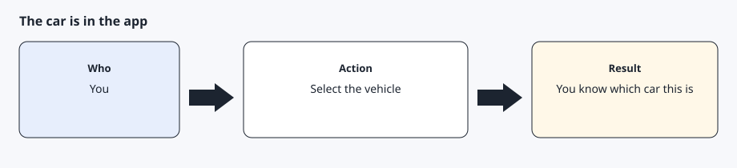
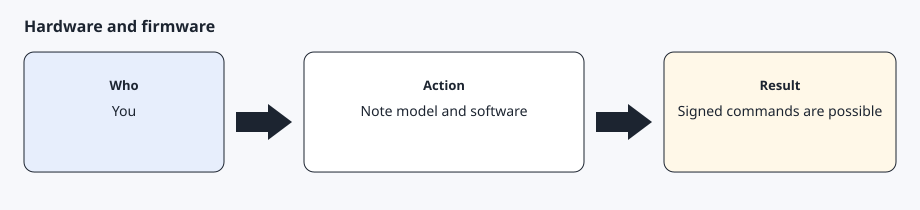
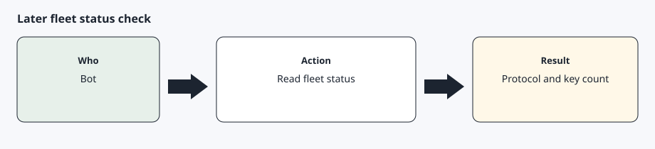

# A car that can take a virtual key

[Back to the checklist](../00-before-you-start.md)

Signed commands work when the car speaks the command protocol and has room for another key. Tesla's vehicle endpoints describe `fleet_status`, which reports `vehicle_command_protocol_required`, firmware, and the key count. A maximum of 20 keys is supported.

| Topic | Detail |
| --- | --- |
| Unsupported hardware | Pre-2018 Model S and Model X cars are reported as unsupported hardware. |
| Needs signed commands | Pre-2021 Model S and Model X are called out in Tesla's vehicle-command docs as not requiring the command proxy. Newer cars require a signed command, which is what `tesla-control` sends. |
| Firmware floors | Firmware earlier than 2023.20 is reported unsupported for a direct call. The command-proxy path documents 2024.26 as a floor, and 2025.20 for Intel Atom Model S and Model X. Firmware 2023.38 and later returns location only when `location_data` is requested. |

This page is generic. It is not a record of a particular car. You confirm the car in the app. The AI agent reads fleet status only after sign-in works.

## Step 1 — See the car in the app



Select the car you intend to connect. If you have more than one, pick one and stay with it. The later pairing link can take a vehicle selection inside the app. Do not send the AI agent the VIN.

## Step 2 — Note the model generation and software version



In the car, open the software screen and read the version. Compare it with the table above. If the software is older than the floor for your hardware, update the car before you expect commands to work.

## Step 3 — Let the AI agent read fleet status later



After tokens exist, the AI agent can call fleet status and tell you whether the command protocol is required, whether a key is missing, and whether the key list is full. That call is a read. It does not add the key. Adding the key is still the phone step in the virtual-key guide.

## Expected result

You know which car you are connecting, you have seen its software version, and you understand that pairing is a separate phone approval. No VIN was pasted into chat.

## Common errors

Fleet status later says `unsupported_hardware` or `unsupported_firmware`. Commands will not succeed until the car matches Tesla's current floors. Do not keep retrying a signed command.

Fleet status says `missing_key`. That is expected until you finish pairing.

The key count is already 20. Remove a key you recognize as unused before adding another. Do not remove a key you do not recognize without checking the car first.

## Prompt for the AI agent

Copy this only when you want the AI agent to do the part below. It must not invent approvals.

```text
Explain whether my car can take a virtual key, using only the model generation and software version I type. Do not ask for the VIN. Compare what I tell you with these notes, then stop.
1. Unsupported hardware: pre-2018 Model S and Model X.
2. Needs signed commands: pre-2021 Model S and Model X do not require the command proxy. Newer cars require a signed command.
3. Firmware floors: firmware earlier than 2023.20 is unsupported for a direct call. The command-proxy path uses 2024.26 as a floor, and 2025.20 for Intel Atom Model S and Model X. Firmware 2023.38 and later returns location only when location_data is requested.
```
