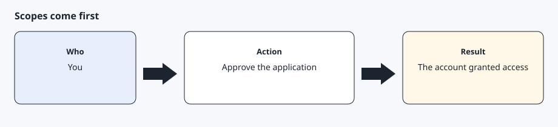
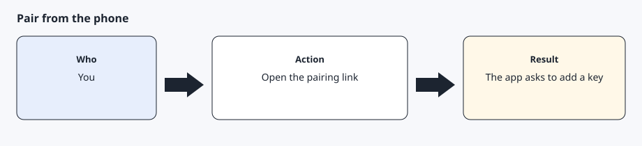
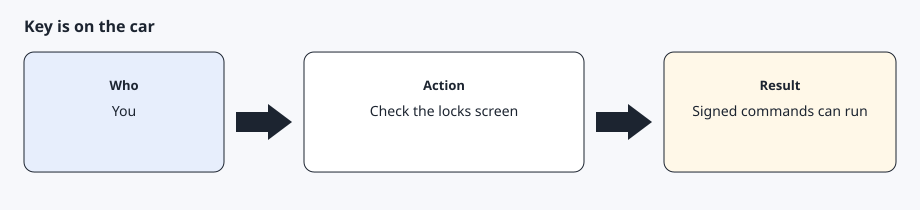

# Pair the key in the official app

[Back to the checklist](../00-before-you-start.md)

Tesla's virtual-key guide says a personal vehicle does not receive the key from Tesla's servers. A person with access adds it in the official app. Do this only after the public key is online and you have granted `vehicle_device_data`, `vehicle_cmds`, or `vehicle_location`.

The link format is `https://tesla.com/_ak/<your-hostname>`. You open it on the phone. The AI agent only builds the link. Pairing is free.

## Step 1 — Grant scopes before you open the link



Finish owner sign-in first. If you open the pairing link before the account has granted a scope, the app can refuse. The AI agent should give you the link only after token exchange succeeds.

## Step 2 — Open the pairing link on the phone



On the phone that is signed into the owner account, open `https://tesla.com/_ak/your-username.github.io` (the hostname you published). Use the phone's browser, not an in-app browser, with the Tesla app installed, and stand near the car. The app should ask you to add the key. If you have more than one car, select the one you chose on the compatibility page. Approve it yourself. A remote desktop session is a poor substitute for the phone. An in-app browser often never hands the link to the app.

## Step 3 — Confirm the key is listed



On the car's locks screen, the new key should appear under the hostname you registered. Tesla's fleet status uses `missing_key` when it is absent and reports `total_number_of_keys` toward the maximum of 20. A signed command is the practical test: a parked lights flash that exits 0 and is followed by a fresh read.

## Expected result

The locks screen shows the key for your github.io hostname, and a later parked lights flash succeeds once.

## Common errors

The app says the key cannot be added. Confirm the public-key URL still returns the same PEM, and confirm sign-in granted a scope. Then open the link again. Do not generate a second key pair unless you intend to publish and register that new public key.

The car already has 20 keys. Remove one you recognize before adding this one.

An unfamiliar key is already listed. Treat that as a reason to check the car before you add another. See SECURITY.md.

## Prompt for the AI agent

Copy this only when you want the AI agent to do the part below. It must not invent approvals.

```text
After token exchange has succeeded, build the pairing link from the hostname in ~/.config/agentdrive/public-key-url (or $AGENTDRIVE_HOME/public-key-url). The link looks like https://tesla.com/_ak/your-username.github.io (the hostname you published). Give me that link and stop. Do not claim the key is paired until I tell you I approved it in the official app. Do not send a vehicle command in this turn.
```
